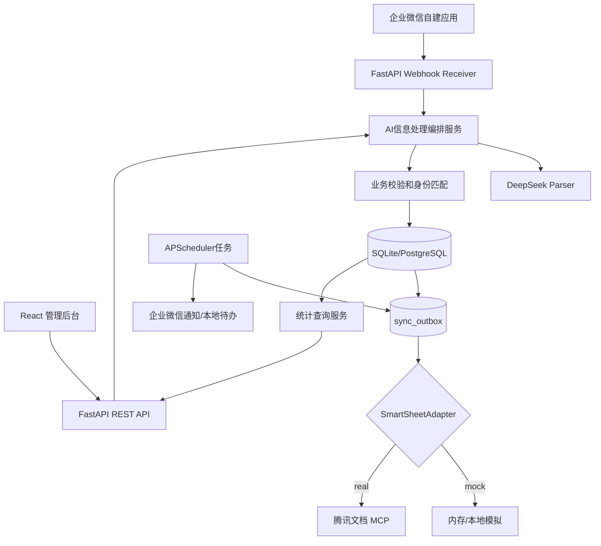

# 03｜技术架构与模块设计

## 1. 选型（固定）

S3实际：保留全部业务技术栈，最小单实例定时扫描采用FastAPI lifespan内的asyncio循环，无新增APScheduler依赖。数据库租约/任务token、事务外IO和持久Mock均已实现；下方APScheduler图示为原目标方案，后续需要复杂调度时再按依据引入。腾讯写入仍因无授权Schema阻断。

- React + TypeScript + Vite + npm + Ant Design + React Router + Axios + ECharts。
- Python 3.11+ + FastAPI + Pydantic 2 + SQLAlchemy 2 + Alembic + Pytest。
- SQLite 开发与小规模单实例；PostgreSQL 为可选生产升级，不在 MVP 强制依赖项。
- DeepSeek Chat Completions JSON Output，模型名可配置，官方模型可能更新。
- 腾讯文档远程 MCP 实现 `SmartSheetAdapter`，必须动态发现实际工具；无授权时 `MockSmartSheetAdapter`。
- 企业微信自建应用回调+加密验签与发送接口，Mock 模式隔离。
- 单实例 APScheduler 扫描 outbox / reminders；多实例前必须引入分布式协调。

## 2. 架构图



## 3. 核心链路

消息接入 -> 签名校验/授权 -> 幂等事件创建 -> 规则预解析 -> DeepSeek JSON抽取（必要时） -> Pydantic结构校验 -> 候选人/申请 ID匹配 -> 状态机校验 -> 事务写 DB+业务审计+Outbox -> 异步文档同步 -> 结果反馈/待办。

**交易边界**：数据库业务事务不调用外部 MCP；先持久化成功，再异步执行出站同步。外部调用失败不得回滚已确认的业务数据。用户界面明确区分 `saved_local` 与 `synced_remote`。

## 4. 后端模块划分（目标仓库）

```text
backend/
  app/
    api/v1/          # routes: auth, candidates, applications, interviews, ingestion, confirmation, dashboard, sync, integrations
    core/            # settings, security, logging, timezone
    db/              # session, migrations, models
    schemas/         # Pydantic request/response
    repositories/    # repository 查询封装
    services/        # ingestion, parser, matching, state_machine, metrics, notification, outbox
    integrations/    # deepseek, wecom, smartsheet_adapter, mock_smartsheet, tencent_mcp
    jobs/            # scheduler, retry, reminders
  alembic/
  tests/unit/ tests/integration/ tests/contract/
```

依赖方向：`api -> services -> repositories / integrations`，`services` 不直接 import FastAPI Request 对象；前端不持有 DeepSeek / 腾讯文档 Token。

## 5. 前端模块划分

```text
frontend/
  src/
    app/            # Router, Providers, auth
    pages/          # Dashboard, Candidates, ApplicationDetail, AIInbox, Tasks, SyncCenter, Settings
    components/     # CandidateTable, StatusTag, Timeline, ConfirmDrawer, EmptyState, ErrorState
    features/       # domain-specific hooks, schemas
    services/       # typed Axios clients
    types/          # API response interfaces
    styles/         # global theme and responsive styles
```

UI 数据只从后端 REST API 获取；统计图表不使用硬编码业务数值。针对 loading/empty/error/success 建立统一组件。

## 6. AI 编排

- 优先用规范化规则识别申请编号与可确定状态词，无法解析时再调用 DeepSeek。
- 使用 `response_format={"type":"json_object"}`（若模型/接口支持），确保系统提示词含 JSON 与示例。
- 即便返回合法 JSON，也要 Pydantic 和业务规则二次校验；空文本/截断/非法枚举触发最多一次受控重试，之后待确认。
- 避免把候选人联系方式、简历正文、评价意见全文默认发送外部模型；尽量使用匿名标识。
- 从模型输出得到 `proposed_action`，永远不直接给模型 SQL/HTTP 写权限。

## 7. 腾讯文档 MCP 集成

- 官方地址：https://docs.qq.com/openapi/mcp；Header `Authorization: <个人Token>`（实际企业身份和使用条件先核实）。
- `tools/list` 获取真实接口集。重点识别 `smartsheet.list_tables`, `smartsheet.list_records`, `smartsheet.add_records`, `smartsheet.update_records`。
- 不假设 MCP 参数的名字、字段格式或返回结构；对真实 schema 建立契约测试并做字段映射。
- 统一实现接口：`health_check()`, `upsert_application(application, remote_id?)`, `list_remote_records()`。
- 本地 `remote_record_id` 作为幂等映射，先查映射后更新；远端记录可能已被手动删除时标记需人工处理，不盲目新增重复条目。
- 真实授权未完成则切换 mock，UI 展示 MOCK/NOT_CONFIGURED，禁止伪造成功的远端同步。

## 8. 企业微信回调

- GET 验证 `echostr`，POST 校验签名、解密消息；验证 timestamp、nonce 防止重放。
- 实际加解密按企业微信官方算法和经过验证的 SDK 实现，不得自行简化 AES。
- 先快速 ACK 并将事件持久化，后端异步处理，避免 5 秒级重复回调。
- 群机器人只能用来通知；不能把被动读取普通群聊写为默认能力。

## 9. 一期运行模式

- `APP_MODE=mock`：无需任何第三方凭证，演示完整 CRM 业务链路和模拟同步。
- `APP_MODE=hybrid`：使用真实 DeepSeek，但腾讯文档/企业微信仍 mock，适合调试 NLP。
- `APP_MODE=live`：必须先检查三方凭证及权限、回调安全和生产 RBAC，缺失即拒绝启动相关服务。

## 10. 参考

腾讯文档官方 MCP 指南：https://developer.cloud.tencent.com/mcp/server/11803
DeepSeek JSON：https://api-docs.deepseek.com/zh-cn/guides/json_mode/
企业微信回调规范：https://wdk-docs.github.io/wework-docs/server/dev-guide/callback-setting/
