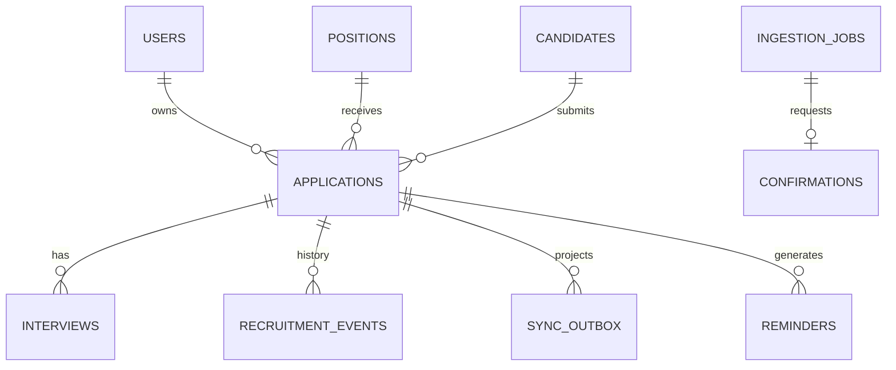

# 04｜数据模型、约束与状态机

## S2 增量

0002_s2增加ingestion_jobs.processing_token/processing_started_at，已接收、解析和终态在独立事务内留痕；source+external_event_id继续唯一。extracted_json保存脱敏摘要、强类型提取/结果及调用元数据，不保存模型原始响应。confirmation关联ingestion，保存申请版本快照、候选选项、原提议、人工修正及处理人时间；处理采用状态/版本条件更新。

interviews.scheduled_at/interviewer允许null，仅用于“已知结果但原计划未知”的事实记录。安排面试仍要求实际时点和面试官。降级若存在缺原计划记录会拒绝，不能为通过迁移编造时间。所有新增业务/确认/接入状态变化继续同事务写审计和outbox；模型网络调用在事务之外。

## S1 实现口径

十二类目标表已建模，另有idempotency_records保存幂等请求哈希与响应。UUID字符串主键、UTCDateTime、SQLite外键已启用；首个Alembic版本0001_s1。Candidate.display_name与独立Position取代S0的name/岗位文本，Application使用application_code、candidate_id、position_id、owner_id、source_channel、stage/outcome、custom_fields、version和软删除时间。读取投影保留candidate_name/position_title，前端不依赖表结构。

User/Position/Candidate/Application/Interview/IngestionJob/Confirmation/Reminder拥有version与时间/软删除基础；Event/Audit/Outbox是历史/任务记录。业务修改产生同事务审计和每实体版本唯一outbox。候选人改名、岗位改名同时递增关联申请版本并投影；面试结果不自动修改申请stage。

开发权限：HR本人、经理所属部门只读、管理员全局；联系方式字段只作为未来加密存储预留，不提供写入/返回接口。扩展字段目前仅允许organization.referral_tag字符串（1~120字符）；未注册键、嵌套对象及核心字段伪装均拒绝。

状态白名单为applied→screening→interview_1→interview_2→offer→hired，人工可记录rejected/withdrawn；普通跳阶段或逆转409，终态逆转创建confirmation、保持原申请版本与状态。完整确认处理在S2。下方为原始目标设计，以上述S1实际模型和运行契约为当前依据。

> 前后端字段命名、ID/时间/版本、生成流程与扩展流程以 [13-统一数据契约与扩展规范](13-统一数据契约与扩展规范.md) 为准。S1已从Starter整数主键升级为UUID关联；下表为领域数据字典，实际约束以Alembic与模型为准。

## 1. 核心表

| 表名 | 关键字段（建议） | 主要约束 |
|---|---|---|
| users | id, external_wecom_userid, display_name, role, active | userid唯一；角色 HR/MANAGER/ADMIN |
| positions | id, title, department, target_headcount, owner_user_id, active | 目标人数非负 |
| candidates | id, display_name, contact_encrypted, created_at, deleted_at | 个人信息加密，逻辑删除 |
| applications | id, application_code, candidate_id, position_id, owner_id, source_channel, stage, outcome, version, created_at, updated_at | application_code 唯一，version乐观锁 |
| interviews | id, application_id, round, scheduled_at, interviewer, status, result, feedback_at | round>=1，日期采用UTC |
| recruitment_events | id, external_event_key, application_id, actor_id, source, event_type, before_json, after_json, raw_text_redacted, created_at | external_event_key 唯一（非空） |
| ingestion_jobs | id, message_hash, source, external_event_id, state, extracted_json, error_code, received_at | 按source+external_event_id唯一 |
| confirmations | id, ingestion_id, reason, candidates_json, proposed_json, status, resolved_by, resolved_at | 一个审核任务只能完成一次 |
| sync_outbox | id, entity_type, entity_id, op, payload_json, status, attempts, next_retry_at, last_error, created_at | 每次状态版本单独任务 |
| remote_record_links | id, entity_type, entity_id, provider, remote_table_id, remote_record_id, last_synced_version | (entity_type, entity_id, provider) 唯一 |
| reminders | id, application_id, reminder_type, due_at, status, sent_at, dedupe_key | dedupe_key 唯一 |
| audit_logs | id, actor_id, action, target_type, target_id, metadata_json, created_at | 不保存凭证明文 |

## 2. 重要建模原则

- 一名候选人可对应多个岗位申请；不允许仅通过 `(name, position)` 判断绝对唯一。
- `application_code` 唯一且用户可在消息中直接使用。内部 UUID 和对外编号分开。
- `version` 用于更新冲突控制：`UPDATE ... WHERE id = ? AND version = ?`；冲突返回 409。
- 所有时间落库 UTC；展示和业务时效计算使用 `APP_TIMEZONE=Asia/Shanghai`。
- 用户与数据均有可见性边界；后端每次查询均应用 RBAC 与负责人过滤。
- 报表以数据库现有的业务事实生成，而非根据对话原文或模型描述统计。

## 3. 状态机

### 3.1 当前阶段（stage）
`applied → screening → interview_1 → interview_2 → offer → hired`。

异常终态包括 `rejected` 与 `withdrawn`。可配置跳过轮次，如直接 `screening -> offer`，但需事前配置允许路径。

### 3.2 状态转移校验

- 任何终态 (`hired/rejected/withdrawn`) 到普通状态须人工确认并留痕。
- 只能由已授权 HR 更新自己负责的申请；负责人可查看其管理范围，管理员有审计权限。
- 面试 `passed` 是上一轮结果，不自动代表下一轮 `passed`。
- “候选人取消面试”不等于 `withdrawn`，必须区分 interview.status 和 application.stage。
- `offer_sent / offer_accepted / offer_rejected` 应通过独立 offer 状态或事件明确表达；不得将发送 Offer 误计入接受 Offer。

## 4. ER 关系

## 5. 外部文档字段映射（初版）

| 内部字段 | 腾讯智能表格字段显示名 | 类型建议 |
|---|---|---|
| application_code | 申请编号 | 文本，唯一业务键 |
| candidate.display_name | 候选人 | 文本 |
| position.title | 应聘岗位 | 文本/单选 |
| owner.display_name | 招聘负责人 | 文本/成员（依据权限） |
| source_channel | 招聘来源 | 单选 |
| stage | 当前阶段 | 单选 |
| next_interview_at | 下次面试时间 | 日期时间 |
| latest_result | 最近面试结果 | 单选 |
| updated_at | 最后更新时间 | 日期时间 |
| sync_version | 系统同步版本 | 数字/文本 |

注意：这只是逻辑映射；实际 MCP 工具传参及字段类型必须通过真实 schema 探测后确定。禁止把显示名称当作固定 field_id。

## 6. 索引与保留策略

- applications(application_code), applications(stage, updated_at), applications(owner_id, updated_at)
- ingestion_jobs(source, external_event_id), sync_outbox(status, next_retry_at), remote_record_links(entity_type, entity_id, provider)
- 支持业务要求的保留期限配置与候选人删除/匿名化流程；不可永久无条件保留所有原始消息。
