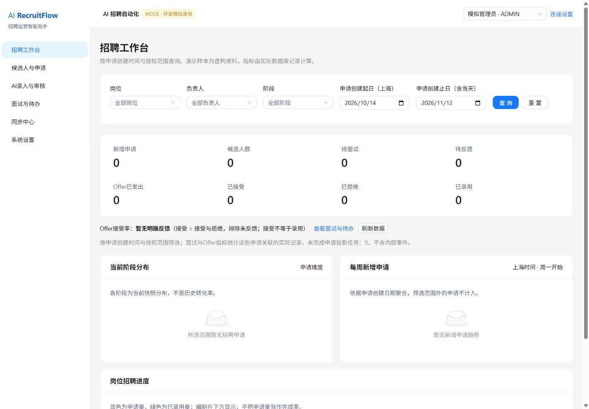
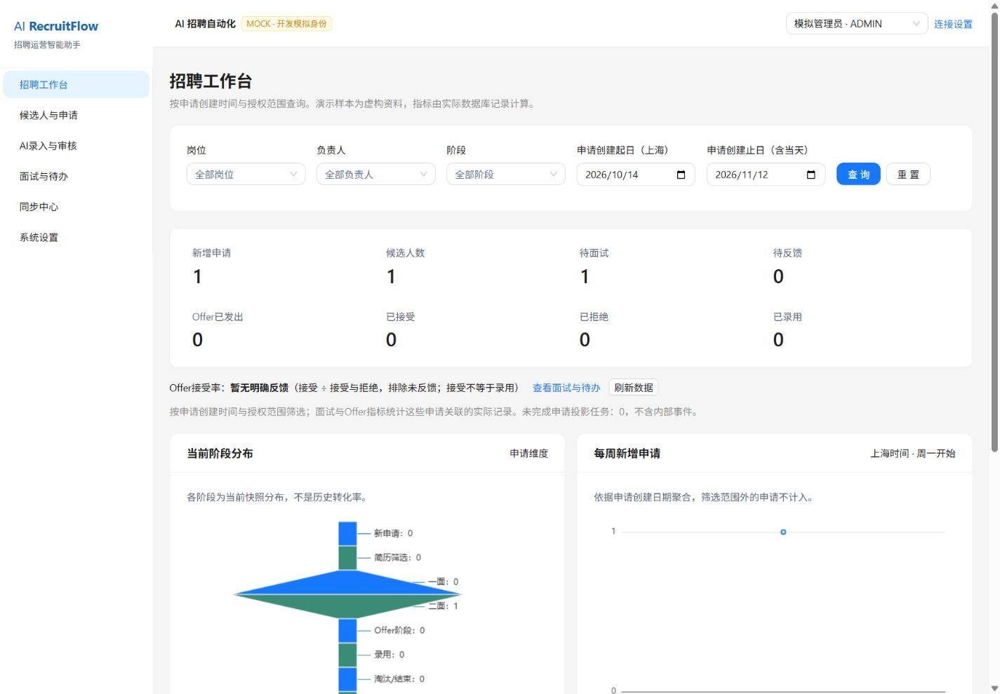

# 16｜S7 端到端验收与可复现演示

2026-11-12完成本轮Mock交付验收。当前业务契约OpenAPI0.7.0/41路径、数据库head0006_s6，没有新增业务API或迁移。真实外部接入的授权验收继续单列，不能由Mock或合成transport替代。

## 1. 本轮结果与证据

| 层次 | 实际执行 | 结果 |
|---|---|---|
| 本机Windows | contracts、lint、Pyright/TS、pytest、Vitest、build、三套隔离Mock HTTP及合成SSO HTTP | 全通过；206后端+20前端，失败0、跳过0 |
| GitHub Windows runner | 新建venv、按哈希安装requirements.lock、npm ci、同一acceptance命令 | 226通过，T01–T18全部通过 |
| GitHub Linux runner | 同样从锁文件安装并执行完整验收 | 226通过，T01–T18全部通过 |
| GitHub Linux Docker | 两份Compose config、实际构建API/web镜像、启动并等待健康、Nginx代理/安全header、生产静态资源与Mock业务HTTP | 通过，结束后停止runner内栈 |
| 本机浏览器 | 新空库、1440/1024/390、AI新增/结果/人工补时点/Mock同步/统计变化/越权拒绝 | 通过，只有虚构数据 |

最终成功运行：[Release acceptance #43206404969](https://github.com/GMZLXL/AI_RecruitFlow/actions/runs/43206404969)，验证代码提交`244d1369a5b4c7196a9dc2f06f4f074afd052799`。后续仅文档/演示证据提交由workflow的paths-ignore跳过相同代码重跑。

本机验收汇总：[acceptance.json](demo/s7/acceptance.json)；真实CI元数据：[ci-result.json](demo/s7/ci-result.json)。已下载并核对两平台的result.json：均226通过、0失败、0跳过、18项矩阵通过；CI产物保留14天，仓库中的汇总和截图长期可查。详细JUnit仅保存在忽略目录和CI artifacts，不提交数据库或原始日志。

本机最终pytest30.53秒、Vitest29.90秒、build12.29秒。耗时只代表本次环境，不代表业务性能承诺。模型响应使用MockTransport的项目不得作为真实DeepSeek效果或延迟评测。

## 2. T01–T18矩阵

下表是本轮实际测试结果；T16另有真实浏览器空库证据。完整测试函数及状态在acceptance.json，不将缺失/跳过/失败计为通过。

| ID | 结果 | 主要证据 |
|---|---|---|
| T01 新增候选人 | 通过 | 原完整Mock流与三条业务消息；candidate/application/event/audit/outbox落地 |
| T02 唯一编号更新 | 通过 | 同一申请登记一面结果，未新建申请；浏览器与HTTP复验 |
| T03 重复回调 | 通过 | 相同Mock MessageId三次仅一次入库/处理，持久ACK与模拟通知 |
| T04 同名冲突 | 通过 | 两条同名申请进入审核，人工选定后只改一条，审核/事件重放不重复写 |
| T05 多岗申请 | 通过 | 同候选人两个申请ID，更新一条后另一条仍applied |
| T06 终态逆转 | 通过 | 终态逆转保留待确认，原申请阶段不变 |
| T07 模糊时间 | 通过 | 不猜时点，人工补具体时间再执行；390px真实操作 |
| T08 Offer未回复 | 通过 | sent不计accepted及接受率分母，接受不自动录用 |
| T09 模型空响应 | 通过（合成HTTP） | DeepSeek transport空白，恰好两次尝试，完整管线进入审核，业务未改 |
| T10 注入 | 通过（合成HTTP/本机） | 恶意输入零模型调用；非法模型字段/SQL/Key响应被拒绝，API/审核不泄露合成canary |
| T11 文档超时 | 通过（Mock） | 本地业务保留，退避/死信/管理员版本幂等重试后恢复 |
| T12 文档幂等 | 通过（Mock） | 远端成功而本地ACK失败，恢复后仍一条Mock记录/同一远端ID |
| T13 并发修改 | 通过 | 过期版本409、幂等重放及并发回归保留较新数据 |
| T14 未授权查看 | 通过 | HR范围与管理员接口限制；浏览器HR乙直接打开管理员申请被拒绝 |
| T15 看板 | 通过 | 独立SQL+Python日历对账角色/日期/岗位/人数/申请/Offer/未来与过去面试 |
| T16 前端空态 | 通过 | 组件空表/空图，真实新空库显示0及暂无反馈，没有示例行 |
| T17 外部配置全空 | 通过 | 独立新库/清空三方secret与文件回退，真实HTTP完整Mock链路 |
| T18 live安全门槛 | 通过 | 缺生产身份/SSO/Key/回调配置、未验证腾讯Schema和完整live均失败关闭 |

## 3. 一条命令复验

按根README安装Python/Node/npm依赖后，在仓库根执行：

```powershell
npm run acceptance
```

命令串行执行契约、lint、类型、全量pytest/Vitest、build、新数据库与本机8027/5177的三套HTTP冒烟、隔离生产模式合成SSO检查。结果在`.tools/s7-acceptance-<随机ID>/`，包含backend.xml/frontend.xml/result.json。测试用SQLite和演示库各自独立，正常开发库不会被清空。结束会停止本轮启动的HTTP服务。

需要8027/5177空闲；占用会明确失败，先停止占用的本次演示进程再复验，不杀不明进程或静默换端口。只想验证隔离HTTP：

```powershell
npm run demo:isolated -- --verify
```

这会创建独立库并生成24条明确标注的虚构演示样本，运行http/workbench/wecom三套冒烟，自动退出，保留忽略目录供排查。`--verify`的应用Key不调用真实服务，三方provider始终Mock。

## 4. 浏览器演示步骤

```powershell
npm run demo:isolated
# 默认打开 http://127.0.0.1:5177
# 如端口另有用途，可显式选择两个空闲端口：
npm run demo:isolated -- --api-port 8037 --web-port 5187
```

每次生成新的空库，不修改日常`.env`/数据库；Ctrl+C结束两服务。这里只做虚构Mock演示，不保存真实Key或个人资料。密钥在本次隔离进程中生成，不能将这套一次性演示库作为正式密钥存储或恢复流程。

1. 工作台全部0、接受率“暂无明确反馈”；候选人列表有明确空态。
2. AI录入输入`新增虚构S7演示甲应聘测试工程岗`，点击解析，记录实际返回的申请编号。
3. 每个新业务先点“新建事件”，依次提交`<实际编号>进入筛选`、`<实际编号>进入一面`、`<实际编号> 一面通过`。
4. 再提交`<实际编号> 安排二面 明天下午 面试官虚构王`，确认进入审核而非猜测钟点。
5. 在390px审核抽屉补一个**当前时点之后**的上海具体日期/钟点，填虚构核对说明，再点“修正并执行”。本次记录时间为2026-11-13 15:00，日后复演须换未来时间；不要机械复用过期日期。
6. 进入详情：一面通过、原计划未知；二面为已安排/待反馈，两者分开。同步中心显示Mock远端ID和模拟已同步。
7. 回工作台：1位候选人、1条申请、1场待面试，Offer/录用仍0。切模拟HR乙直接打开上述详情，显示无权；最后恢复模拟管理员。

本轮独立库位于忽略的`.tools/s7-demo-cb282d23`，申请编号`A75A93BFEF1F2`，version5。1440/1024/390均已实际查看；1024宽1024、手机审核宽390，无页面横向溢出。录制只反映该虚构库，不反映日常数据库的统计。

## 5. 录制证据

[44秒Mock关键帧录像](demo/s7/demo.mp4)由实际浏览器截取的11张桌面关键帧各停留4秒编码而成，**不是连续实时录屏，也不是生成的界面视频**。另有390px审核和1024px详情截图。原操作时间/页面/说明在[recording.json](demo/s7/recording.json)，13张原始截图均保留；没有修改业务值、伪造画面或对外发送消息。





视频可选复现：具备FFmpeg时按recording.json顺序选择桌面帧（排除07/08多尺寸帧），concat每帧4秒，`fps=12`、1440×1000等比pad、H.264/yuv420p、`-movflags +faststart`；FFmpeg不是应用/验收必需依赖。

## 6. 修复与仍待验收项

- 补入官方`@ant-design/v5-patch-for-react-19@1.0.3`，解决既有React19下AntD5静态渲染兼容问题；组件实际断言审核成功消息可见。保留一条静态message不消费动态主题上下文的开发提示，不谎称零告警。
- 首轮CI两个平台Mock验收均通过，容器已健康；HTTP步骤直接执行`http.py`遮蔽标准库http，失败并未算通过。改为backend目录下`python -m scripts.smoke.http`后，最终三作业全通过，没有删除或放宽断言。
- 修复生产手册CLI示例role大小写（HR而非hr）、README过时的“未配置远程”与旧阶段限制；API、状态机、权限和迁移没有放宽。

| 尚未执行 | 原因/完成所需 |
|---|---|
| 真实DeepSeek与准确率 | 有效授权Key/可用模型；至少60条脱敏标注样本与人工复核，实际调用评测。当前不宣称95%准确率或性能达标 |
| 腾讯文档真实写入 | 授权Token、独立测试表/文件/表ID，先tools/list取得真实Schema，再验证字段映射/会员与查询→新增→更新→复查 |
| 企业微信租户 | 管理员授权、自建应用参数、限定HTTPS回调、可见范围/成员绑定及真实URL校验/通知结果 |
| 企业SSO/TLS与生产覆盖运行 | 受信网关、真实issuer/audience/公钥、HTTPS origin、主密钥/CSRF、显式DB授权；网关本身不是本应用已实现能力 |
| PostgreSQL/macOS | PostgreSQL只验证离线DDL，无实例恢复/业务实测；macOS无实机 |
| P1增强 | AI周报、导入导出、自动归档等未交付，不列入本次Mock通过项 |

仍有Starlette测试客户端弃用和538.13KB主包警告。支持单实例SQLite、单API进程内存限流；正式业务环境仍需授权接入、容量/恢复与安全审查，Mock交付不等于正式上线。
